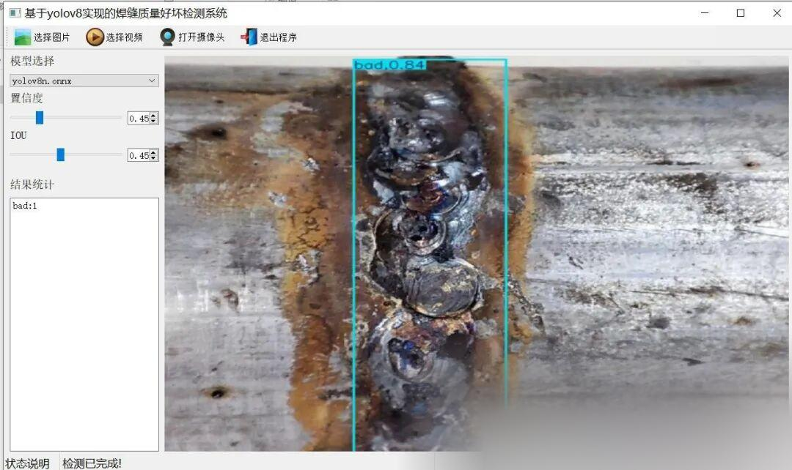
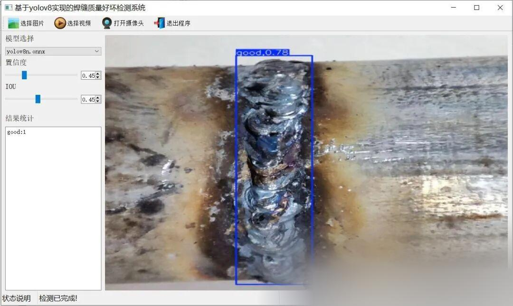

# Weld Quality System Based on YOLOv8 Python Source Code + ONNX Model + Evaluation Indicator Curve + High-quality GUI Interface

[Algorithm Introduction]

A weld quality detection system based on YOLOv8 is an efficient and accurate automated solution specifically designed for the industrial welding field. This system utilizes the advanced deep learning framework YOLOv8, combined with efficient network architectures such as CloAtt, to achieve precise identification and evaluation of weld quality.

The system collects and labels a large amount of welding image data. Train a model capable of identifying welding defects. During the detection process, The system can capture welding images in real time. Use the trained model to quickly analyze and judge the welding quality. Provide detailed test results at the same time. Including the location of defects. Types and confidence levels, etc.

Compared with traditional manual inspection methods, the weld quality detection system based on YOLOv8 has higher detection efficiency and accuracy, which can significantly reduce labor costs, improve production efficiency and product quality. In addition, this system also has good generalization ability and robustness, capable of meeting the needs of weld quality detection under different welding processes and complex environmental conditions.

In summary, the weld quality detection system based on YOLOv8 is an important technological innovation in the field of industrial welding. It plays a significant role in improving weld quality and ensuring product safety.

[Effect Display]





[Test Environment]

windows10
anaconda3+python3.8
torch==1.9.0+cu111
ultralytics==8.2.70

The model can detect the category.

good,bad

[Training Information]

| Parameter | Value |
| ----------- | -------- |
| Training set images count | 1020 |
| Validation set images count | 114 |
| Training map | 99.5% |
| Training precision (Precision) | 99.6% |
| Training recall rate (Recall) | 100% |

[Training dataset (Note: Due to potential differences between the dataset optimization and the training dataset)]

[Partial Implementation Source Code]

-
-
-
-
-
-
-
-
-
-
-
-
-
-
-
-
-
-
-
-
-
-
-
-
-
-
-
-
-
-
-
-
-
-
-
-
-
-
-
-
-
-
-
-
-
-
-
-
-
-
-
-
-
-
-
-
-
-
-
-
-
-
-
-
-
-
-
-
-
-
-
-
-
-
-
-
-
-
-
-
-
-
-
-
-
-
-
-
-
-
-
-
-
-
-
-
-
-
-
-
-
-
-
-
-
-
-
-

```
class Ui_MainWindow(QtWidgets.QMainWindow):    signal = QtCore.pyqtSignal(str, str)     def setupUi(self):        self.setObjectName("MainWindow")        self.resize(1280, 728)        self.centralwidget = QtWidgets.QWidget(self)        self.centralwidget.setObjectName("centralwidget")         self.weights_dir = './weights'         self.picture = QtWidgets.QLabel(self.centralwidget)        self.picture.setGeometry(QtCore.QRect(260, 10, 1010, 630))        self.picture.setStyleSheet("background:black")        self.picture.setObjectName("picture")        self.picture.setScaledContents(True)        self.label_2 = QtWidgets.QLabel(self.centralwidget)        self.label_2.setGeometry(QtCore.QRect(10, 10, 81, 21))        self.label_2.setObjectName("label_2")        self.cb_weights = QtWidgets.QComboBox(self.centralwidget)        self.cb_weights.setGeometry(QtCore.QRect(10, 40, 241, 21))        self.cb_weights.setObjectName("cb_weights")        self.cb_weights.currentIndexChanged.connect(self.cb_weights_changed)         self.label_3 = QtWidgets.QLabel(self.centralwidget)        self.label_3.setGeometry(QtCore.QRect(10, 70, 72, 21))        self.label_3.setObjectName("label_3")        self.hs_conf = QtWidgets.QSlider(self.centralwidget)        self.hs_conf.setGeometry(QtCore.QRect(10, 100, 181, 22))        self.hs_conf.setProperty("value", 25)        self.hs_conf.setOrientation(QtCore.Qt.Horizontal)        self.hs_conf.setObjectName("hs_conf")        self.hs_conf.valueChanged.connect(self.conf_change)        self.dsb_conf = QtWidgets.QDoubleSpinBox(self.centralwidget)        self.dsb_conf.setGeometry(QtCore.QRect(200, 100, 51, 22))        self.dsb_conf.setMaximum(1.0)        self.dsb_conf.setSingleStep(0.01)        self.dsb_conf.setProperty("value", 0.25)        self.dsb_conf.setObjectName("dsb_conf")        self.dsb_conf.valueChanged.connect(self.dsb_conf_change)        self.dsb_iou = QtWidgets.QDoubleSpinBox(self.centralwidget)        self.dsb_iou.setGeometry(QtCore.QRect(200, 160, 51, 22))        self.dsb_iou.setMaximum(1.0)        self.dsb_iou.setSingleStep(0.01)        self.dsb_iou.setProperty("value", 0.45)        self.dsb_iou.setObjectName("dsb_iou")        self.dsb_iou.valueChanged.connect(self.dsb_iou_change)        self.hs_iou = QtWidgets.QSlider(self.centralwidget)        self.hs_iou.setGeometry(QtCore.QRect(10, 160, 181, 22))        self.hs_iou.setProperty("value", 45)        self.hs_iou.setOrientation(QtCore.Qt.Horizontal)        self.hs_iou.setObjectName("hs_iou")        self.hs_iou.valueChanged.connect(self.iou_change)        self.label_4 = QtWidgets.QLabel(self.centralwidget)        self.label_4.setGeometry(QtCore.QRect(10, 130, 72, 21))        self.label_4.setObjectName("label_4")        self.label_5 = QtWidgets.QLabel(self.centralwidget)        self.label_5.setGeometry(QtCore.QRect(10, 210, 72, 21))        self.label_5.setObjectName("label_5")        self.le_res = QtWidgets.QTextEdit(self.centralwidget)        self.le_res.setGeometry(QtCore.QRect(10, 240, 241, 400))        self.le_res.setObjectName("le_res")        self.setCentralWidget(self.centralwidget)        self.menubar = QtWidgets.QMenuBar(self)        self.menubar.setGeometry(QtCore.QRect(0, 0, 1110, 30))        self.menubar.setObjectName("menubar")        self.setMenuBar(self.menubar)        self.statusbar = QtWidgets.QStatusBar(self)        self.statusbar.setObjectName("statusbar")        self.setStatusBar(self.statusbar)        self.toolBar = QtWidgets.QToolBar(self)        self.toolBar.setToolButtonStyle(QtCore.Qt.ToolButtonTextBesideIcon)        self.toolBar.setObjectName("toolBar")        self.addToolBar(QtCore.Qt.TopToolBarArea, self.toolBar)        self.actionopenpic = QtWidgets.QAction(self)        icon = QtGui.QIcon()        icon.addPixmap(QtGui.QPixmap(":/images/1.png"), QtGui.QIcon.Normal, QtGui.QIcon.Off)        self.actionopenpic.setIcon(icon)        self.actionopenpic.setObjectName("actionopenpic")        self.actionopenpic.triggered.connect(self.open_image)        self.action = QtWidgets.QAction(self)        icon1 = QtGui.QIcon()        icon1.addPixmap(QtGui.QPixmap(":/images/2.png"), QtGui.QIcon.Normal, QtGui.QIcon.Off)        self.action.setIcon(icon1)        self.action.setObjectName("action")        self.action.triggered.connect(self.open_video)        self.action_2 = QtWidgets.QAction(self)        icon2 = QtGui.QIcon()        icon2.addPixmap(QtGui.QPixmap(":/images/3.png"), QtGui.QIcon.Normal, QtGui.QIcon.Off)        self.action_2.setIcon(icon2)        self.action_2.setObjectName("action_2")        self.action_2.triggered.connect(self.open_camera)         self.actionexit = QtWidgets.QAction(self)        icon3 = QtGui.QIcon()        icon3.addPixmap(QtGui.QPixmap(":/images/4.png"), QtGui.QIcon.Normal, QtGui.QIcon.Off)        self.actionexit.setIcon(icon3)        self.actionexit.setObjectName("actionexit")        self.actionexit.triggered.connect(self.exit)         self.toolBar.addAction(self.actionopenpic)        self.toolBar.addAction(self.action)        self.toolBar.addAction(self.action_2)        self.toolBar.addAction(self.actionexit)         self.retranslateUi()        QtCore.QMetaObject.connectSlotsByName(self)        self.init_all()
```

[Usage Steps]

Usage Steps:
1. First, install the YOLOv8 environment according to the official framework https://github.com/ultralytics/ultralytics and PyQt5 installation tutorial.
2. After switching to your installed YOLOv8 environment, navigate to the source code directory and execute python main.py to start the interface for operation.

[Provided Files]

Python source code
YOLOv8n.onnx model (without PyTorch model)
Training map, P, R curves (in weights\results.png)
Test images (under test_img folder)


## Payment

Here is a pay link on Stripe ( https://buy.stripe.com/3cs8yP7sY87d0vu9AB ). Please contact me lonlonago@foxmail.com after funding $89, and I will send you a complete data files , thank you!


